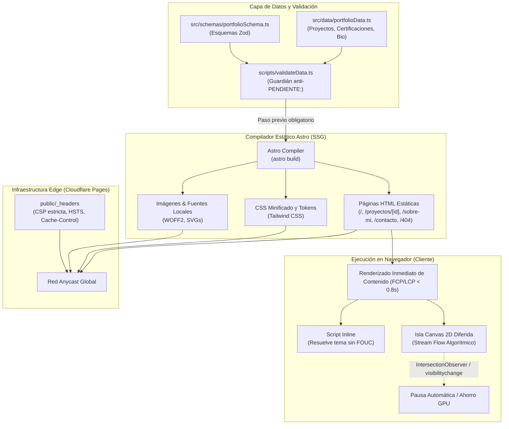

# Arquitectura del Sistema

Última actualización: 2026-11-06

---

## 1. Visión General y Principios de Diseño

El portafolio de **Marcio Gonzalo Sequeiros Palomino** está concebido bajo el principio de **"Ingeniería visible y rendimiento sin compromiso"**. Cada decisión técnica refleja la especialidad del autor: arquitecturas de datos, concurrencia, pipelines de streaming y sistemas transaccionales críticos.

### Principios Rectores:
1. **0 KB JS por Defecto para Contenido**: Todo el contenido textual, imágenes y estructura se entregan como HTML y CSS estático prerenderizado (SSG).
2. **Islas de Interacción Aisladas**: Los componentes interactivos (Selector de tema con prevención de FOUC, visualización algorítmica de Canvas 2D) se cargan de forma diferida o inline crítica según corresponda, sin bloquear el despliegue del LCP.
3. **Fuente Única de Verdad (Single Source of Truth)**: Los proyectos, certificaciones, experiencia laboral y enlaces están centralizados en `src/data/portfolioData.ts`, tipados y validados estrictamente con Zod.
4. **Costo $0/mes y Cero Fricción Operativa**: Desplegable como directorio estático puro (`dist/`) en Cloudflare Pages o GitHub Pages.

---

## 2. Diagrama de Arquitectura y Flujo de Datos



---

## 3. Registro Inicial de Riesgos (Sección 17)

| ID | Riesgo | Probabilidad | Impacto | Mitigación | Estado |
| --- | --- | --- | --- | --- | --- |
| **R-01** | Las cuotas o condiciones del hosting cambian | Media | Alto | Registrar fuentes y fechas en `DEPLOYMENT.md`; generar directorio estático agnóstico; migración en 1 comando a GitHub Pages | Abierto |
| **R-02** | La animación degrada rendimiento en equipos modestos | Media | Alto | Presupuesto por frame ≤ 3 ms, `Float32Array`, auto-pausa fuera de vista y en pestaña oculta, degradación a SVG estático con `prefers-reduced-motion` | Abierto |
| **R-03** | Datos personales o proyectos sin confirmar se publican | Media | Alto | Prefijo `PENDIENTE:` bloquea el script `validate:data` y aborta la compilación de producción con exit code 1 | Abierto |
| **R-04** | Entorno sin navegador o sin Lighthouse | Media | Medio | Detección realizada en Fase 0: Playwright y Lighthouse disponibles vía npx; comandos reproducibles en `QA.md` | Mitigado |
| **R-05** | Dependencia vulnerable o abandonada | Baja | Medio | Solo dependencias esenciales fijadas en `package.json`, ejecución de `npm audit` en `verify` | Abierto |
| **R-06** | Cabeceras de seguridad no soportadas por el hosting | Media | Medio | Generación de archivo `_headers` probado para Cloudflare Pages; validación documentada | Abierto |
| **R-07** | Regresión de accesibilidad tras cambios visuales | Media | Alto | Verificación de contraste semántico (≥ 4.5:1), foco accesible, navegación con teclado y lector de pantalla documentada | Abierto |
| **R-08** | Sobreingeniería (dependencias o abstracciones superfluas) | Media | Medio | Adhesión estricta a la Invariante 6: Cero frameworks SPA pesados en el cliente, JavaScript nativo modular | Abierto |

---

## 4. Estructura de Directorios

```
/
├─ src/
│  ├─ components/          Componentes Astro semánticos (Navbar, Footer, Hero, ProjectCard, Metrics, etc.)
│  ├─ layouts/             BaseLayout.astro (metadatos, OpenGraph, JSON-LD, script inline de tema)
│  ├─ pages/               Rutas estáticas: index.astro, proyectos/[id].astro, sobre-mi.astro, contacto.astro, 404.astro
│  ├─ data/                portfolioData.ts (fuente única de verdad con tipado estricto)
│  ├─ schemas/             portfolioSchema.ts (esquemas Zod)
│  ├─ lib/                 Utilidades puras (formateadores, utilidades matemáticas para animación)
│  ├─ generative/          StreamAnimation.ts (Canvas 2D procedimental) y StreamStaticFallback.astro
│  └─ styles/              global.css (tokens de diseño, variables CSS, utilidades de accesibilidad)
├─ public/                 Favicon SVG/PNG, _headers, _redirects, robots.txt, sitemap.xml
├─ scripts/                validateData.ts (auditor de consistencia y guardián de PENDIENTE:)
├─ tests/                  Pruebas unitarias de esquema, utilidades y pruebas de integración/E2E
├─ docs/                   QA.md, ARCHITECTURE.md, DESIGN_SYSTEM.md, DEPLOYMENT.md, PROGRESS.md, decisions/
└─ package.json
```

